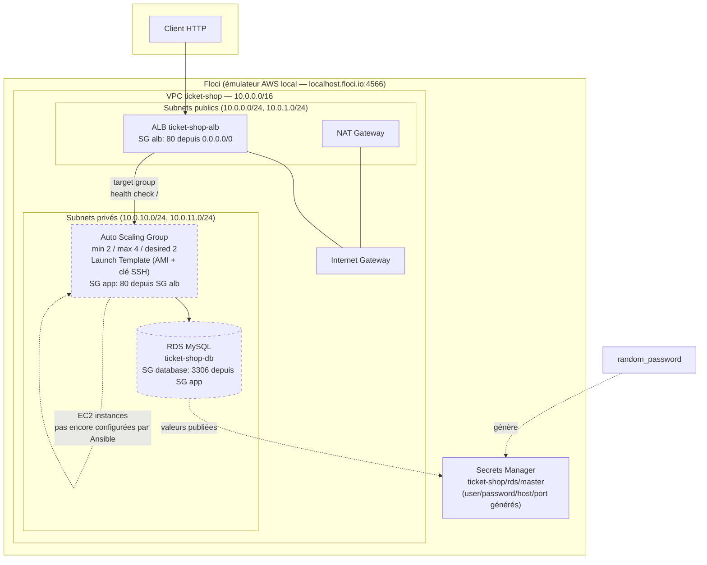

# Architecture actuelle (état du code Terraform)

Ce schéma reflète ce qui est réellement provisionné par [`terraform/`](../terraform) à ce stade — pas encore la cible complète décrite dans le [README](../README.md#1-architecture) (EFS et présentation applicative PrestaShop restent à faire via Ansible).

## Ce qui est en place

- **Réseau** : 1 VPC, 2 subnets publics + 2 subnets privés (2 AZ), Internet Gateway, NAT Gateway + EIP, tables de routage.
- **Sécurité** : 3 security groups (`alb`, `app`, `database`) déclarés avec les bonnes restrictions logiques — ⚠️ non appliquées par Floci (voir limite documentée dans [`modules/security/main.tf`](../terraform/modules/security/main.tf) et confirmée par [floci-io/floci#2564](https://github.com/floci-io/floci/issues/2564)).
- **Calcul** : ALB public + target group (health check `/`) + listener HTTP, Launch Template, Auto Scaling Group (2-4 instances), policy de scaling target-tracking CPU.
- **Base de données** : RDS MySQL en subnet privé, mot de passe généré (`random_password`), publié dans un secret Secrets Manager unique (`ticket-shop/rds/master`) au format JSON (`username`, `password`, `host`, `port`, `dbname`).

## Ce qui manque encore (prochaines étapes)

- **EFS** (stockage médias partagé entre instances) — pas encore codé.
- **Ansible** : inventaire dynamique, rôles `docker`/`prestashop`, lecture du secret RDS, déploiement du conteneur PrestaShop sur les instances de l'ASG — les instances EC2 existent mais ne font tourner aucune application pour l'instant.
- **Backend Terraform distant** (S3 + DynamoDB) — actuellement état local, à migrer.
- **Séparation d'environnements** (dev/staging/prod).
- **Multi-région** — voir [architecture-multi-region.md](architecture-multi-region.md) pour le plan cible.
