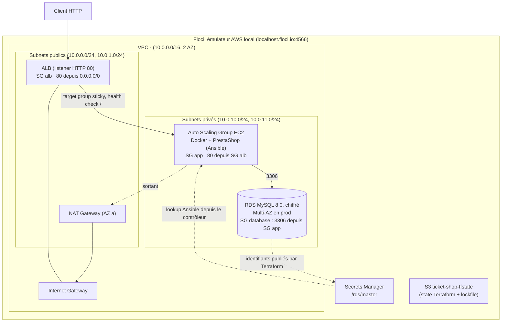

# Architecture : Taylor Shift's Ticket Shop

## 1. Schéma

## 2. Ce qu'elle fait

1. **Réception** : le client appelle le nom DNS de l'ALB, seul composant exposé à Internet.
2. **Répartition** : l'ALB transmet la requête à une instance saine du target group. Un cookie d'affinité (1 h) renvoie ensuite le même client vers la même instance.
3. **Traitement** : sur l'instance, le conteneur PrestaShop (Apache + PHP) interroge la base RDS.
4. **Montée en charge** : deux politiques _target tracking_ visent 600 requêtes par instance et par minute, et 60 % de CPU moyen. L'ASG ajoute ou retire des instances entre `min_size` et `max_size` : il ajoute dès qu'une politique le demande, il retire seulement si les deux sont d'accord.
5. **Panne d'une instance** :
   1. après 3 health checks en échec (environ 45 s), l'ALB ne lui envoie plus de trafic ;
   2. l'ASG (health check de type `ELB`) la termine et en relance une nouvelle ;
   3. ses clients sont redirigés vers une autre instance et perdent leur session (panier, connexion).
6. **Panne de la base** (prod, Multi-AZ) : RDS bascule sur sa réplique dans l'autre AZ.

## 3. Pourquoi ces choix

| Composant       | Choix                                                           | Pourquoi                                                                                                                                                                  |
| --------------- | --------------------------------------------------------------- | ------------------------------------------------------------------------------------------------------------------------------------------------------------------------- |
| Réseau          | 1 VPC sur 2 AZ, subnets publics (ALB, NAT) et privés (EC2, RDS) | Seul l'ALB est exposé. Deux AZ permettent de survivre à la perte d'une zone                                                                                               |
| Sécurité        | SG chaînés`alb` → `app` → `database` par référence de SG        | Chaque couche n'accepte que la précédente, sans dépendre des IP                                                                                                           |
| Entrée          | Application Load Balancer                                       | Répartit la charge, retire les instances malades et donne un endpoint stable                                                                                              |
| Application     | PrestaShop en Docker sur EC2, dans un Auto Scaling Group        | Le sujet impose EC2 et Ansible. L'image Docker Hub officielle évite de maintenir une installation PHP. L'ASG apporte le scaling horizontal et le remplacement automatique |
| Scaling         | Target tracking : 600 requêtes/instance/min (`ALBRequestCountPerTarget`) et 60 % de CPU | L'ouverture d'une vente est un pic soudain. Le nombre de requêtes monte dès l'arrivée du trafic, alors que le CPU ne monte qu'une fois les instances saturées (et PrestaShop peut être limité par RDS ou les I/O, avec une latence qui grimpe pour un CPU modéré). Le CPU reste un filet pour les requêtes lourdes (paiement, back-office). Avec deux politiques, l'ASG monte dès qu'une le demande et ne descend que si les deux sont d'accord. Le seuil de 600 est une estimation à calibrer par test de charge ; une instance met plusieurs minutes à démarrer |
| Sessions        | Affinité par cookie de l'ALB (`lb_cookie`, 1 h)                 | Chaque instance a son volume Docker local (config générée à l'installation, cache, médias envoyés), sans EFS ni store de sessions partagé. Sans affinité, un client répartit ses requêtes sur plusieurs instances et peut perdre panier ou connexion au back-office. Solution peu coûteuse mais pas une vraie solution : répartition moins homogène (les nouvelles instances ne reçoivent que les nouveaux clients) et session perdue si l'instance tombe. La vraie réponse serait EFS et des sessions partagées (ElastiCache ou base) |
| Données         | RDS MySQL managé, chiffré, Multi-AZ en prod                     | Sauvegardes, correctifs et failover sont fournis par AWS. La base, avec état, reste hors du scaling applicatif, sans état                                                 |
| Secret          | `random_password` → Secrets Manager → lookup Ansible            | Le mot de passe n'est jamais écrit ni dupliqué : une seule source de vérité                                                                                               |
| Sortie Internet | Une NAT Gateway                                                 | Les instances privées peuvent télécharger Docker et l'image, sans IP publique. Une seule NAT, par choix de coût                                                           |
| Inventaire      | `ansible_host` / `ansible_group` dans le state Terraform        | Ansible lit ce que Terraform a créé : aucune IP ni aucun hôte recopiés à la main                                                                                          |
| State           | S3 +`use_lockfile`                                              | State partagé par l'équipe, protégé des`apply` simultanés, sans table DynamoDB                                                                                            |
| Environnement   | Floci                                                           | Émule AWS en local, sans compte ni coût. Le code reste portable vers AWS : seuls les endpoints du provider changent                                                       |
