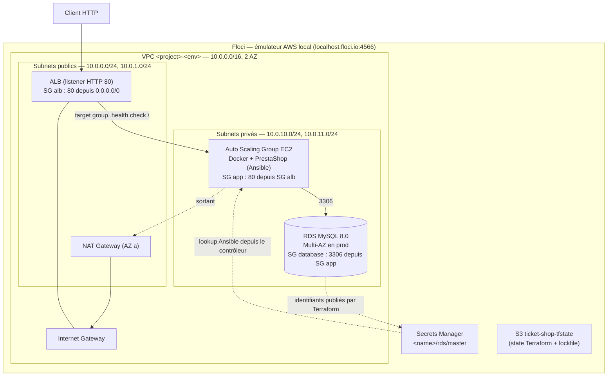

# Architecture — Taylor Shift's Ticket Shop

État réel du code (§1 à §4) puis plan d'évolution multi-région (§5).

## 1. Schéma



## 2. Composants et placement

| Couche | Ressource | Module Terraform | Pourquoi ce choix |
|---|---|---|---|
| Réseau | VPC, 2 subnets publics et 2 privés sur 2 AZ, IGW, NAT, routage | `network` | Seul l'ALB est exposé ; les instances et la base restent en privé |
| Sécurité | SG `alb` → `app` → `database`, chaînés par référence de SG | `security` | Chaque couche n'accepte que la précédente |
| Entrée | ALB + target group (health check `/`, toutes les 15 s) + listener HTTP 80 | `compute` | Répartit la charge et sort les instances malades |
| Application | Launch template (Debian 12) + ASG, politique target tracking à 60 % de CPU | `compute` | EC2 imposé par le sujet ; Ansible garde la main sur la configuration |
| Données | RDS MySQL managé, stockage chiffré, Multi-AZ activable par environnement | `database` | Sauvegardes et failover fournis par AWS, hors du scaling applicatif |
| Secret | `random_password` → Secrets Manager (JSON : user, password, host, port, dbname) | `database` | Une seule source de vérité, lue par Ansible |
| Inventaire | `ansible_host` / `ansible_group` (provider `ansible/ansible`) | racine (`ansible.tf`) | L'inventaire Ansible est dérivé du state, rien n'est saisi à la main |

## 3. Chemin d'une requête et scaling

1. Le client appelle le nom DNS de l'ALB.
2. L'ALB transmet la requête à une instance saine du target group.
3. Apache/PrestaShop (conteneur Docker) interroge RDS.
4. Le target tracking CPU ajoute ou retire des instances entre `min_size` et `max_size`.
5. **Si une instance tombe** : après 3 health checks en échec (environ 45 s), l'ALB ne lui envoie plus de trafic. L'ASG, dont le health check est de type `ELB`, la termine et en relance une nouvelle.

## 4. Limites connues

| Limite | Conséquence | Piste |
|---|---|---|
| Les nouvelles instances de l'ASG ne sont pas configurées automatiquement | Une instance ajoutée par le scaling ou le remplacement sert une page d'erreur tant qu'on n'a pas relancé `terraform apply` puis `ansible-playbook` | AMI préconstruite (Packer), `ansible-pull` dans le `user_data`, ou déclenchement par un lifecycle hook de l'ASG |
| L'inventaire compte `desired_capacity` hôtes, figés au moment de l'`apply` | Les instances ajoutées par le scaling automatique n'y figurent pas. Un `terraform apply` ramène aussi l'ASG à `desired_capacity` | Idem ci-dessus |
| Délai de grâce du health check de 30 min (`health_check_grace_period`) | Laisse le temps de lancer Ansible après l'`apply`, mais une instance neuve défaillante n'est remplacée qu'après ce délai | À réduire une fois la configuration faite au démarrage de l'instance |
| Pas de stockage partagé (EFS) | Chaque instance garde ses propres médias et uploads | EFS monté dans `/var/www/html/img` |
| Sessions PHP locales | Un panier peut être perdu si la requête change d'instance | Sticky sessions sur l'ALB ou sessions dans Redis/ElastiCache |
| Pas de cache applicatif | RDS reste le goulot d'étranglement sous forte charge | ElastiCache, CDN pour les assets |
| Une seule NAT Gateway | Si son AZ tombe, les instances perdent l'accès sortant (le service HTTP continue) | Une NAT par AZ, au prix d'un coût supplémentaire |
| Failover RDS Multi-AZ | Coupure de quelques dizaines de secondes | Inhérent à RDS |
| HTTP uniquement | Pas de TLS | Listener 443 + certificat ACM |

Les limites propres à l'émulateur (security groups non appliqués, header `Host` réécrit, Docker-in-Docker…) sont décrites dans [terraform/README.md §4](../terraform/README.md#4-limites-dues-à-floci) et [ansible/README.md §6](../ansible/README.md#6-limites-dues-à-floci).

## 5. Évolution : multi-région

### Cible

```
                         Route 53 (latency + failover, health checks)
                    ┌───────────────────┴───────────────────┐
         Région A (primaire)                        Région B (secours)
         ALB → ASG PrestaShop                       ALB → ASG réduit (warm standby)
         EFS ────── réplication planifiée ────────► EFS
         RDS writer ── read replica cross-region ─► RDS replica (promue en cas de bascule)
```

### Bascule

1. Route 53 fait des health checks sur l'ALB de chaque région et envoie le trafic vers B si A ne répond plus.
2. La read replica RDS de B est promue en writer. L'opération est manuelle au départ, puis pourra être automatisée par une Lambda déclenchée par une alarme.
3. Les médias EFS sont répliqués par AWS Backup ou DataSync : leur fraîcheur dépend de la fréquence de réplication.

### Choix

- **Read replica cross-region** plutôt qu'Aurora Global : suffisant pour MySQL/PrestaShop, et moins coûteux.
- **Warm standby** en région B : la bascule évite un démarrage à froid, pour un coût contenu.
- **Multi-région réservé à `prod`** : `dev` et `staging` restent mono-région.

### Limites

- **RPO non nul** : la réplication est asynchrone.
- **RTO de quelques minutes** : la promotion de la réplique est manuelle.
- **Coût** : environ le double de l'infrastructure.

### Impact sur le code

- **Terraform** : un module `region` (network, compute, database, storage) instancié deux fois avec des alias de provider, plus un module `dns` pour Route 53.
- **Ansible** : l'inventaire regroupe les hôtes par région (`region_a`, `region_b`).
- **Floci** : Floci n'émule qu'une seule instance. Les deux providers pointent vers le même endpoint : seule la structure est démontrable, pas une vraie panne régionale.
